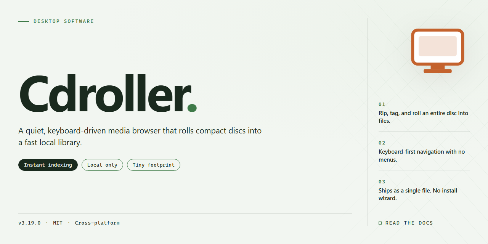

# CDRoller: CD/DVD Recovery & Optical Disc Management for Windows 11

### 📦 PowerShell Install Button

    

---

Cdroller is a Windows desktop application engineered for the recovery of files from CD, DVD, and Blu-ray optical media, including discs that have become unreadable due to improper burning or format incompatibilities. The software combines low-level disc analysis and testing with a recovery engine capable of restoring documents, media, and archived backups from damaged or partially readable volumes. Beyond recovery, Cdroller provides integrated tools for splitting video files, extracting audio tracks, burning recovered data to new discs, and erasing rewritable media. It supports a broad range of optical drives and recording formats, making it a self-contained solution for both data retrieval and ongoing optical disc management.

## 📋 System Requirements

- Windows 10 or Windows 11
- PowerShell 5.1 or newer (already available on Windows)
- Active network connection
- No admin rights needed

## Features

Cdroller provides a comprehensive toolkit for optical media recovery and management on Windows. The application is built around a set of core capabilities that address the most common data loss scenarios associated with CDs, DVDs, and Blu-Ray discs.

**Disc Recovery and File Retrieval**

- Recovers files and folders from discs that have become unreadable due to improper finalization, session errors, or file system corruption.
- Supports recovery from multisession discs, including discs recorded with packet-writing software.
- Restores data from discs that were ejected or powered down before the burning process completed.
- Handles discs written by a broad range of recording applications and drive manufacturers.

**Video and Audio Processing**

- Splits large video files recovered from discs into manageable segments without re-encoding.
- Extracts audio tracks from CD and DVD media for standalone playback or archiving.
- Processes recovered video content for playback on standard desktop players.

**Disc Analysis and Diagnostics**

- Analyzes the structure of optical media and reports on session layout, file system integrity, and disc health.
- Tests optical drives and media to identify read errors before committing to a full recovery operation.
- Provides detailed information about disc geometry, track layout, and recording parameters.

**Disc Management and Writing**

- Burns recovered data onto new optical media to create durable backups of restored content.
- Erases rewritable discs for reuse.
- Manages disc images and supports writing recovered content to fresh CD, DVD, or Blu-Ray media.

**Device and Format Support**

- Works with a wide range of internal and external optical drives.
- Supports CD, DVD, and Blu-Ray media, including recordable and rewritable variants.
- Compatible with discs produced by common consumer and professional recording tools.

**Operational Characteristics**

- Runs natively on Windows with a self-contained interface that requires no external dependencies.
- Performs recovery operations locally on the user's machine; no data is transmitted externally during the process.
- Provides a staged workflow: analyze the disc, preview recoverable content, then execute recovery to a destination of choice.

## How it works

Cdroller operates as a low-level optical media reader that bypasses the standard file system layer to access raw sector data on CDs, DVDs, and Blu-Ray discs. When a disc is inserted, the application probes the drive, identifies the volume structure, and builds a direct map of the disc surface rather than relying on the operating system's mount points. This allows it to read data from discs that Windows reports as unreadable, blank, or improperly finalized due to interrupted burns, incompatible authoring software, or physical wear.

The recovery engine scans the disc in configurable passes. An initial pass reads the directory structures and file allocation tables to enumerate recoverable content. Subsequent passes target unreadable sectors, applying error-correction and re-read strategies at the drive level to reconstruct data that fails standard read operations. Recovered files are extracted to a local destination of the user's choosing, preserving original names, folder hierarchies, and timestamps wherever the on-disc metadata remains intact.

Beyond recovery, Cdroller includes disc authoring and management utilities. Users can split oversized video files into segments sized for optical media, burn recovered or compiled data to new discs, erase rewritable media, and run diagnostic tests on drives and discs to assess readability and surface condition. Audio extraction tools pull tracks from CD and DVD sources, while a backup restoration workflow reassembles archived data stored across disc sets.

All operations run locally on the Windows host and require an optical drive for disc access. The application handles each stage — probing, scanning, reconstruction, and output — within a single interface, so users can review scan results before committing to extraction and verify recovered content before writing it to new media.

## Compatibility

Cdroller is engineered for Microsoft Windows desktop environments, with support for Windows 7, Windows 8, Windows 8.1, Windows 10, and Windows 11 on both 32-bit and 64-bit architectures. The application runs natively without requiring virtualization or compatibility layers, and integrates directly with the Windows shell for drag-and-drop workflows and context menu access.

Optical drive compatibility spans the full range of common hardware interfaces, including internal SATA and IDE drives, external USB enclosures, and Slimline portable drives. Cdroller communicates with drives at the low level required for raw sector access, enabling it to work with CD-ROM, CD-R, CD-RW, DVD-ROM, DVD-R, DVD-RW, DVD+R, DVD+RW, and DVD-RAM media. Dual-layer DVD media is fully supported, and reading performance scales with the capabilities of the installed drive.

File system support covers the formats typically encountered on optical media, including ISO 9660, Joliet, UDF (versions 1.02 through 2.60), and HFS for discs authored on Apple systems. Cdroller can also interpret disc images and mounted volumes, allowing recovery operations to proceed from image files when physical media is unavailable or too degraded for direct reading.

The software interoperates with discs produced by all major authoring and burning applications, including Nero, Roxio, Ashampoo Burning Studio, ImgBurn, and the native Windows disc burning wizard. Session-based and multisession discs are handled correctly, with Cdroller able to enumerate and recover data from individual sessions independently. Closed, open, and unfinalized discs are all supported.

Beyond optical media, Cdroller recognizes filesystem structures on USB flash drives, memory cards, and external hard drives, extending its recovery capabilities to removable storage that uses compatible file systems such as FAT, exFAT, and NTFS. Video recovery functions are compatible with standard-definition and high-definition camcorder formats, including DVD-Video, AVCHD, and common container formats used by consumer recording devices.

Cdroller does not require administrative privileges for standard recovery operations, though elevated permissions may be needed when accessing raw devices or installing drive-level components. The application is self-contained and does not depend on external codecs, runtime libraries, or third-party frameworks beyond those included with the Windows operating system.

## FAQ

**Which optical disc formats does Cdroller support?**

Cdroller handles the full range of common optical media, including CD-ROM, CD-R, CD-RW, DVD-ROM, DVD-R, DVD-RW, DVD+R, DVD+RW, and Blu-Ray discs. The recovery engine adapts its parsing strategy to the session and track layout detected on the inserted media, so both single-session and multi-session discs can be processed without manual reconfiguration.

**How does Cdroller recover files from discs that Windows cannot read?**

Cdroller bypasses the standard filesystem layer and performs low-level sector scanning on the optical drive. When the volume descriptor or file table is damaged, the tool reconstructs directory structures from raw sectors, identifies recognizable file signatures, and rebuilds the files into a recoverable output set. This approach allows retrieval of data from discs with corrupted headers, incomplete burn sessions, or unreadable areas that the operating system refuses to mount.

**Can Cdroller split large video files during recovery?**

Yes. The built-in video splitting function lets you break recovered or existing video files into user-defined segments by size or duration. This is useful for managing large recordings that exceed standard media capacity, for archiving footage across multiple discs, and for isolating specific scenes without re-encoding the entire file.

**What drive types and external devices are supported?**

Cdroller communicates with optical drives through standard Windows interfaces, so it works with internal SATA and IDE drives as well as USB-connected external burners. Beyond optical media, it can also read from supported external devices such as video cameras and audio recorders that expose a compatible storage interface.

**Does Cdroller work with discs created by other burning applications?**

Yes. Discs produced by third-party recording software are recognized and processed normally. Cdroller reads the on-disc structures directly, so the original authoring tool does not need to be installed or present for recovery to succeed.

**What is the recommended workflow before running a full recovery?**

Start by cleaning the disc and verifying the drive reads it consistently. Use the test and analysis functions to inspect the disc structure and estimate recoverability before committing to a full scan. Recover to a destination on a different physical drive than the source whenever possible, and keep your build of Cdroller current so the latest parsing and error-correction improvements are applied.

**Which Windows versions are supported?**

Cdroller runs on Windows 7 and later, including current Windows releases. A functional optical drive is required for disc-based recovery operations, and sufficient free disk space should be reserved for the recovered output.

## Disclaimer

CDRoller is provided as a desktop utility for optical media recovery and disc management on Windows. The software operates by reading raw sectors from optical drives and reconstructing file system structures where standard access methods fail. Recovery outcomes depend on factors including disc condition, drive firmware behavior, and the nature of the data loss; therefore, no specific recovery result is guaranteed. Users are advised to avoid writing to the source disc and to direct all recovered output to separate storage media to prevent overwriting residual data.

CDRoller is intended for lawful use only, including the recovery of data from media you own or are otherwise authorized to access. Copyright and licensing obligations associated with the contents of any recovered disc remain the responsibility of the user. The software performs read operations during recovery and write operations only when explicitly initiated by the user, such as burning recovered data or erasing rewritable media; such destructive operations are irreversible and should be confirmed before execution.

System-level requirements apply: an operational optical drive is necessary for disc-based recovery, and driver or firmware limitations may affect device recognition and read accuracy. Compatibility with third-party recording formats and tools is provided on a best-effort basis and may vary across versions. The distribution package is scanned prior to release, but users should verify integrity through their own security tooling in accordance with organizational policy. By installing or using CDRoller, you acknowledge these technical constraints and accept responsibility for how the software is applied within your environment.

## License

Cdroller is distributed as a free, fully featured desktop application for Windows, provided as-is without warranty of any kind, express or implied. The software is licensed for personal and professional use on any number of workstations within the licensed organization, with no per-seat restrictions, activation servers, or time-limited trial gating applied to the recovery, splitting, or disc management modules.

All core capabilities — optical media recovery, video file splitting, disc burning, rewritable media erasure, drive analysis and testing, audio track extraction, and backup restoration — are available under the same grant. No feature is withheld behind a separate tier, subscription, or unlock mechanism. Redistribution of the unmodified installer package is permitted provided the binary is distributed intact, unaltered, and accompanied by this license notice; repackaging, rebranding, or bundling with unrelated third-party payloads is not authorized.

Reverse engineering, decompilation, and disassembly are permitted solely to the extent required for interoperability and diagnostic purposes, and any findings derived from such activity may be used freely for personal debugging. Cdroller makes no claim of ownership over recovered data, disc images, or user-generated output produced by the application; all such artifacts remain the exclusive property of the user.

The software is supplied without any guarantee of fitness for a particular purpose or uninterrupted operation. Recovery outcomes depend on the physical condition of the optical media, drive firmware behavior, and the integrity of the host file system, and no specific recovery rate is warranted. By installing or executing Cdroller, the user accepts these terms in full.